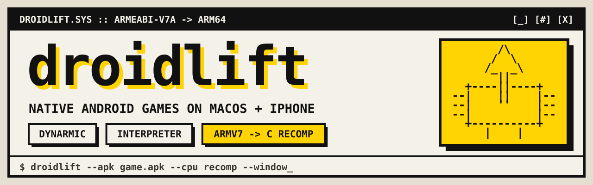

<p align="center">
  <picture>
    <source media="(prefers-color-scheme: dark)" srcset="docs/assets/banner-dark.svg">
    
  </picture>
</p>

<p align="center">
  <a href="https://github.com/thedankest/droidlift/actions/workflows/ci.yml"></a>
  <a href="LICENSE"></a>
  
  
  
</p>

**droidlift runs a native Android game on a Mac or a stock iPhone.** It takes the game's own ARM libraries from an APK you own and links them against host versions of Android's C library, OpenGL ES, audio and asset manager. It needs no Android, no emulator and no paid Apple developer account. On the iPhone, where apps can't JIT, it recompiles the game's ARM code to C ahead of time.

```text
   your APK                     droidlift                          you get
 +-----------+     +-------------------------------------+     +-------------+
 | libgame.so| --> | ELF loader + relocations            | --> | Mac app     |
 | (ARMv7)   |     | bionic / GLES 2 / OpenSL ES shims   |     | iOS app     |
 | assets/   |     | fake JNI   <-- your game profile    |     | (free Apple |
 +-----------+     | CPU: JIT | interpreter | ARM -> C   |     |  ID signed) |
                   +-------------------------------------+     +-------------+
```

> [!IMPORTANT]
> droidlift is a toolkit, not a one-click emulator. Each game needs a small **profile**: C code standing in for the game's Java side. It ports native NDK games, not Java/Kotlin apps. The first port is a 2010s C++ game with FMOD audio. It runs completely on the Mac and on an iPhone 14, on all three CPU backends: title, gameplay, sound, touch and saves.

## Contents

- [Does my game fit?](#does-my-game-fit)
- [Quick start](#quick-start)
- [What a port looks like](#what-a-port-looks-like)
- [CPU backends](#cpu-backends)
- [On the iPhone](#on-the-iphone)
- [Documentation](#documentation)
- [Prior art](#prior-art)
- [Contributing](#contributing) · [Legal](#legal) · [License](#license)

## Does my game fit?

Three checks take a couple of minutes and settle most cases:

```sh
unzip -l game.apk | grep 'lib/armeabi-v7a/'      # 1. 32-bit ARM libraries? (required)
unzip -l game.apk | grep -E 'libunity|libil2cpp|libUE4|libgdx|libcocos2d|libmain'   # 2. which engine?
unzip -p game.apk lib/armeabi-v7a/libgame.so | strings | grep -E 'ANativeActivity_onCreate|libvulkan|libGLESv3|AAudio'  # 3. red flags
```

| Likely fit | Harder (untested so far) | Not supported |
|---|---|---|
| Custom C/C++ engines on GLES 2 with a thin Java shell, the kind most 2010s mobile games used | Engines with a large Java side (cocos2d-x's helpers, Unity's player), NativeActivity games (need new shims) | Java/Kotlin apps, arm64-only APKs, GLES 3 or Vulkan, online-only games |

[docs/limits.md](docs/limits.md) is the honest list of what droidlift doesn't do. Read it before you start.

## Quick start

You need an Apple-silicon Mac with Xcode, CMake 3.24+, Ninja, and Homebrew's `sdl3` and `boost`.

```sh
# 1. a port is its own repository; droidlift is a submodule
cp -R droidlift/examples/template my-port && cd my-port && git init
git submodule add https://github.com/thedankest/droidlift.git droidlift
mkdir original && cp ~/Downloads/game.apk original/      # git-ignored

# 2. dependencies (pinned; ANGLE's first build takes a while)
droidlift/scripts/fetch-deps.sh && droidlift/scripts/fetch-angle.sh

# 3. build, at first without the recompiler
cmake -S . -B build -G Ninja -DDL_RECOMP=OFF && cmake --build build

# 4. do all imports bind?
build/my-game --apk original/game.apk --check

# 5. run it
build/my-game --apk original/game.apk --init-test --window
```

Steps 4 and 5 are where the porting work happens. [docs/porting.md](docs/porting.md) walks through them.

## What a port looks like

A profile in C, plus one CMake call:

```c
#include "droidlift.h"

static const char *const libs[] = {"libengine.so", "libgame.so", NULL};       /* loadLibrary order */
static const char *const classes[] = {"com/example/game/GameLib", NULL};     /* what FindClass finds */

static int init(const char *data_dir) {
  /* The Java methods native code calls: jni_register_method(...) for each. */
  return 0;
}

static int frame(cpu *c, const so_module *m) {
  input_dispatch(c, m);                                                       /* queued touches */
  uint32_t args[] = {jni_env(), jni_find_class("com/example/game/GameLib")};
  cpu_call(c, dl_native(m, "com/example/game/GameLib", "onDrawFrame"), 2, args);
  return c->faulted ? -1 : 0;
}

static const dl_game game = {
    .name = "My Game", .storage = "My Game", .libs = libs, .jni_classes = classes,
    .max_aspect_w = 16, .max_aspect_h = 9, .init = init, .frame = frame,
    /* .start, .surface, .touch, .pause, .stop, .resume ... */
};
DL_MAIN(&game)
```

```cmake
add_subdirectory(droidlift)
droidlift_add_game(my-game
  APK     "${DL_APK}"
  SOURCES game/profile.c
  RECOMP  "libengine:engine:8" "libgame:game:32"     # library:prefix:shards
  APP_NAME MyGame)
```

`dl_native` finds a native method whether the game exports it as `Java_...` or registers it from `JNI_OnLoad`. Every Java method native code calls but you haven't written yet is logged with its signature, so the fake JNI tells you what to implement next.

## CPU backends

| Backend | How | Where | Speed |
|---|---|---|---|
| `dynarmic` | JIT ([dynarmic](https://github.com/azahar-emu/dynarmic)) | Mac, iOS Simulator | native-ish |
| `interp` | droidlift's ARMv7 interpreter: ARM, Thumb-2, VFPv3, NEON | everywhere | slow, but needs nothing from the host |
| `recomp` | the libraries recompiled ahead of time to C and built with clang; the interpreter covers anything discovery missed | everywhere, the iPhone's default | native-ish, no JIT needed |

Pick one at launch with `--cpu`. Every backend is checked against dynarmic: the interpreter by random-instruction and lockstep differential tests, the recompiler by differential tests on sampled functions. [docs/recompiler.md](docs/recompiler.md) describes how the recompiler works.

## On the iPhone

```sh
droidlift/scripts/build-ios-sim.sh && droidlift/scripts/run-ios-sim.sh   # Simulator, no Apple ID
droidlift/scripts/build-ios-device.sh --install                          # your iPhone, free Apple ID
droidlift/scripts/resign-ios.sh                                          # every 7 days
```

The scripts get a free team's provisioning profile through a stub Xcode project, sign outside iCloud, install over the old app so saves survive, and copy the logs back. [docs/ios.md](docs/ios.md) covers all of it, including what a free account can't do.

## Documentation

| | |
|---|---|
| [Porting guide](docs/porting.md) | From an APK to a playable Mac build, then the iPhone |
| [Limits](docs/limits.md) | Where droidlift doesn't generalise, and how to tell quickly |
| [Architecture](docs/architecture.md) | Guest memory, import binding, the fake JNI, threads, the frame loop |
| [Recompiler](docs/recompiler.md) | Decoding, discovery, generated code, the run-time backend |
| [iOS](docs/ios.md) | Simulator, free-team signing, logs, entitlements |
| [Template](examples/template) | A port to copy |
| [Changelog](CHANGELOG.md) | What changed, release by release |

## Prior art

droidlift stands on the shoulders of:

- **The PS Vita `.so` loader ports** (for example [leos-fortune-vita](https://github.com/stoicpingu/leos-fortune-vita)). droidlift's loader layout and fake-JNI approach follow them. The Vita runs ARM code natively; droidlift adds a guest/host boundary, three CPU backends and Apple platforms.
- **Static recompilation projects** such as [N64Recomp](https://github.com/N64Recomp/N64Recomp) and [XenonRecomp](https://github.com/hedge-dev/XenonRecomp). droidlift applies their "every instruction becomes C" approach to ARMv7 shared libraries.
- [dynarmic](https://github.com/azahar-emu/dynarmic) as the JIT and reference CPU, [ANGLE](https://chromium.googlesource.com/angle/angle) for GLES on Metal, and [SDL3](https://libsdl.org) for the window, input and audio.

## Contributing

New shims, new instruction coverage, new discovery patterns and porting reports are all welcome. The fastest way to make droidlift more general is to try it on a new game and report what was missing. See [CONTRIBUTING.md](CONTRIBUTING.md).

## Legal

droidlift contains no game code or assets, and never will. You supply your own copy of a game. Everything derived from a game (unpacked libraries and assets, recompiled C, app bundles) stays in ignored folders and must not be published or distributed. Don't open issues or pull requests that contain game binaries, extracted assets or decompiled game code.

## License

[MIT](LICENSE). The third-party projects droidlift fetches at build time are all under permissive licences: see [THIRD_PARTY.md](THIRD_PARTY.md).
